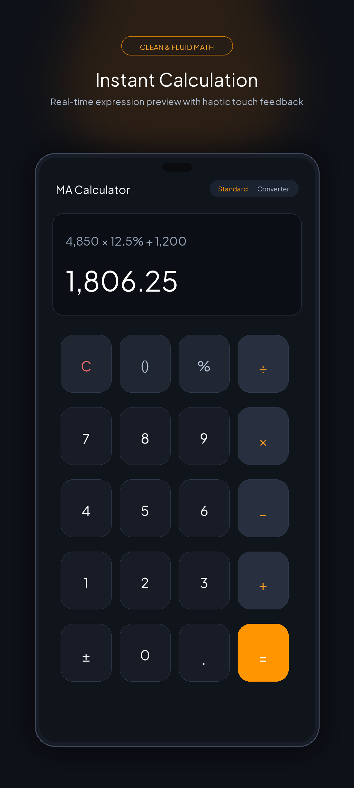
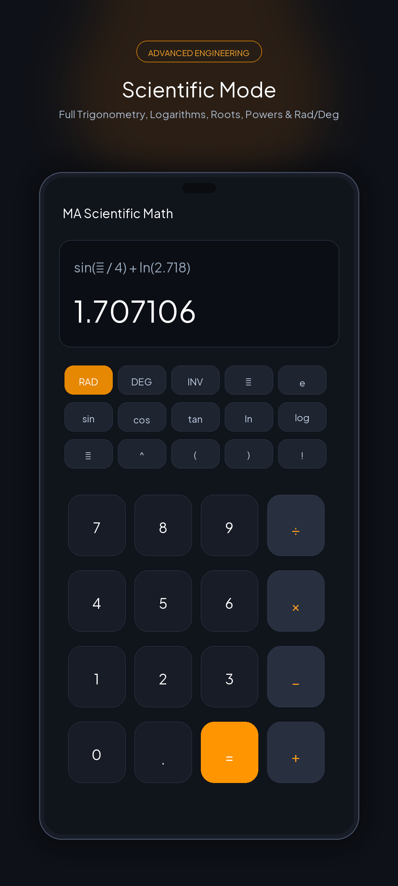
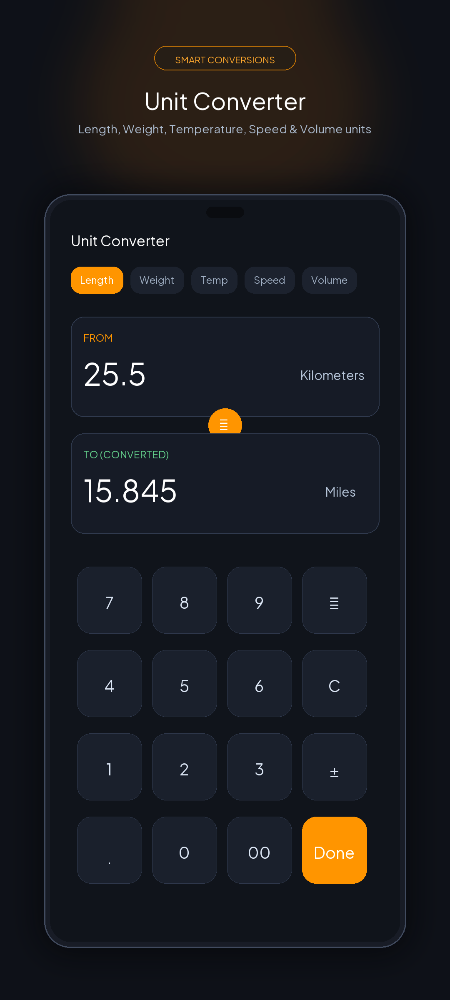
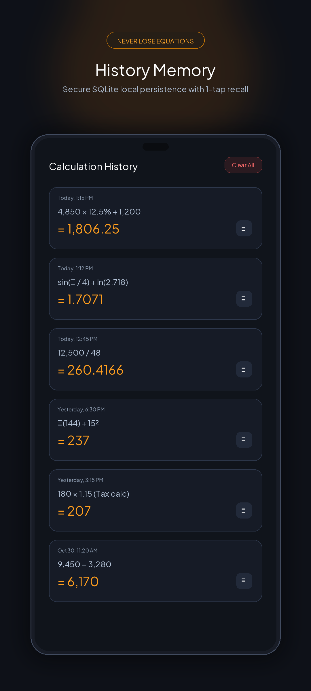
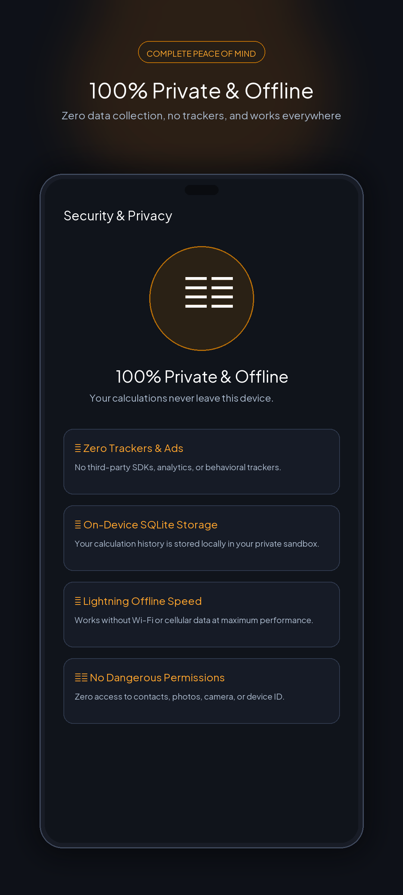

# 📱 MA Calculator - Clean, Fast & Private

[](https://developer.android.com)
[](https://kotlinlang.org)
[](https://developer.android.com/jetpack/compose)
[](https://muzamilahmadofficial.github.io/Calculator/)
[](LICENSE)

A beautiful, modern, precision-engineered Android calculator app built with **Jetpack Compose**, **Material 3**, and **Kotlin**. Designed for daily arithmetic, engineering calculations, and instant multi-unit conversions with a strict privacy-first architecture.

🔒 **Live Privacy Policy:** [https://muzamilahmadofficial.github.io/Calculator/](https://muzamilahmadofficial.github.io/Calculator/)

---

## ✨ Features

- **⚡ Instant Standard Math:** Real-time calculation preview, parentheses, percentages, decimals, negative numbers, and responsive haptic feedback.
- **🔬 Advanced Scientific Mode:** Complete trigonometry (`sin`, `cos`, `tan` and inverses), `RAD`/`DEG` angle toggles, logarithms (`ln`, `log`), arbitrary powers (`^`), square roots (`√`), factorials (`!`), and mathematical constants ($\pi$, $e$).
- **🔄 Multi-Category Unit Converter:** Seamlessly convert between Length, Weight, Temperature, Speed, and Volume units.
- **📝 Local Calculation History:** Secure on-device calculation persistence powered by Room and SQLite. Copy past equations with a single tap.
- **🎙️ Speech-to-Math Voice Input:** Dictate calculations using your device's native speech recognition.
- **🛡️ 100% Private & Fully Offline:** Zero dangerous permissions, zero ads, zero tracking SDKs, and zero internet connection required.

---

## 📸 Screenshots & Showcase

| Standard Calculator | Scientific Mode | Unit Converter | Calculation History | Security & Privacy |
| :---: | :---: | :---: | :---: | :---: |
|  |  |  |  |  |

---

## 🛠️ Tech Stack & Architecture

- **UI Framework:** Android Jetpack Compose + Material 3
- **Language:** Kotlin 2.2
- **Local Persistence:** Room Database + SQLite
- **Architecture:** MVVM (Model-View-ViewModel) + Coroutines Flow StateFlow
- **Design System:** Neumorphic elevated tactile buttons with dynamic Dark/Light theme switching

---

## 🚀 Building & Running

### Prerequisites
- Android Studio Ladybug / Meerkat (or newer)
- JDK 21
- Android SDK Platform 36 (targetSdk 36, minSdk 24)

### Build Debug APK
```bash
./gradlew assembleDebug
```
Output: `app/build/outputs/apk/debug/app-debug.apk`

### Build Production Release Bundle (AAB for Google Play)
```bash
./gradlew bundleRelease
```
Output: `app/build/outputs/bundle/release/app-release.aab`

---

## 📄 Privacy Policy

MA Calculator strictly respects user privacy. No personal data, location data, or device identifiers are collected, transmitted, or shared.

Read our full privacy statement online at [GitHub Pages](https://muzamilahmadofficial.github.io/Calculator/) or view [`docs/index.html`](docs/index.html).

---

## 📜 License

This project is licensed under the MIT License.
